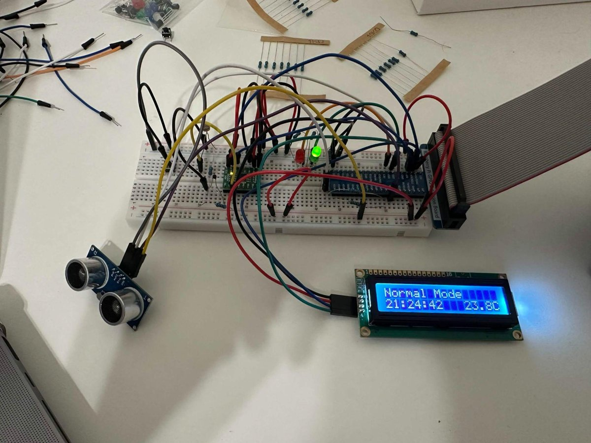
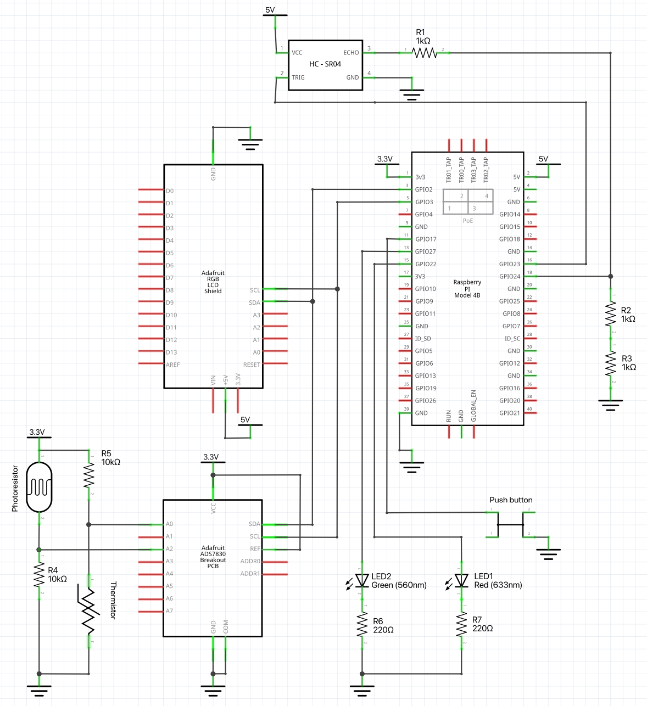
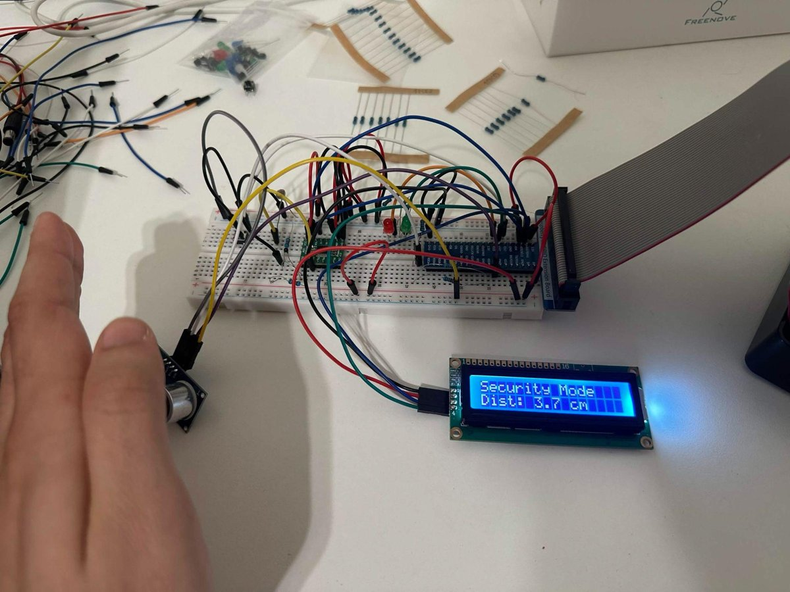

# Smart Home Controller

A Raspberry Pi home monitor with two modes. In **normal mode** it measures room temperature with a thermistor and shows it on an LCD. In **security mode** it watches for motion with an ultrasonic sensor and for light changes with a photoresistor, then blinks an LED and sends an email alert when either one trips. A push button or a terminal command switches between the modes.

Final project for EECS 113 (Processor Hardware/Software Interfaces) at UC Irvine, Spring 2026.



## Features

- **Temperature monitoring.** Reads a 10 kΩ NTC thermistor through an ADC and converts the reading to degrees Celsius with the Beta-parameter equation. The LCD shows the time and temperature, and the green LED is on.
- **Motion detection.** An HC-SR04 ultrasonic sensor flags anything closer than 40 cm.
- **Light-change detection.** A photoresistor flags a change of 120 or more (on a 0–1023 scale) since the last reading, such as a light being turned on or a shadow passing.
- **Email alerts.** On a security event, the red LED blinks and an email goes out over SMTP with the event type, distance, light level and timestamp. A 30-second cooldown keeps it from flooding your inbox.
- **Two ways to switch modes.** Use the push button or type `m` in the terminal.

## Hardware

| Component | Purpose |
|---|---|
| Raspberry Pi 4 Model B with GPIO extension board | Controller |
| 1602 LCD with PCF8574 I2C backpack | Status display |
| ADS7830 8-channel ADC | Reads the analog sensors over I2C |
| 10 kΩ NTC thermistor | Temperature |
| Photoresistor | Light level |
| HC-SR04 ultrasonic sensor | Motion and distance |
| Green and red LEDs | Normal and security mode indicators |
| Push button | Mode switch |
| 220 Ω, 1 kΩ and 10 kΩ resistors, breadboard, jumper wires | |

All parts come from the Freenove Ultimate Starter Kit.

### Wiring

| Signal | Pi pin (BCM) | Notes |
|---|---|---|
| I2C SDA / SCL | GPIO2 / GPIO3 (pins 3 / 5) | Shared bus: LCD at `0x27`, ADS7830 at `0x4B` |
| Push button | GPIO17 (pin 11) | Active low; internal pull-up enabled in software |
| Green LED | GPIO27 (pin 13) | 220 Ω series resistor |
| Red LED | GPIO22 (pin 15) | 220 Ω series resistor |
| HC-SR04 TRIG | GPIO23 (pin 16) | |
| HC-SR04 ECHO | GPIO24 (pin 18) | 1 kΩ / 2 kΩ voltage divider steps the 5 V echo down to about 3.3 V |
| Thermistor | ADC channel A0 | Voltage divider with a 10 kΩ resistor |
| Photoresistor | ADC channel A2 | Voltage divider with a 10 kΩ resistor |

The HC-SR04 and LCD run from 5 V; the ADC and both sensor dividers run from 3.3 V.



In the schematic, the "Adafruit RGB LCD Shield" part stands in for the 1602 I2C LCD, which uses only power, ground, SDA and SCL.

## How it works

The program is a single Python script, `main.py`, organized into three classes:

- `LCDManager` wraps the I2C LCD. If the display stops responding, it disables itself and the program keeps logging to the terminal.
- `ADCReader` talks to the ADS7830 over I2C, probing the device at startup. It scales the 8-bit reading to a 0–1023 range.
- `SmartHomeController` holds the mode, reads the sensors, drives the LEDs and LCD, and sends alerts.

**Concurrency.** The main loop runs once a second and does the work for the current mode. Two other things can change the mode while it runs:

- the push button, through a GPIO falling-edge interrupt with a 300 ms debounce, and
- a background thread that reads commands from the terminal.

A mutex guards the mode so the interrupt callback, the keyboard thread and the main loop never read or write it at the same time. If edge detection isn't available, the main loop polls the button instead, with its own software debounce.

**Distance measurement.** The controller sends a 10 µs trigger pulse, times the echo pulse, and converts the time to distance using the speed of sound (343 m/s). Each wait times out after 40 ms. Readings outside 0–400 cm count as no reading and show as `N/A`.

**Shutdown.** Quitting with `q` or Ctrl+C closes the I2C bus, resets the GPIO pins and clears the LCD.

## Setup

1. Enable I2C on the Pi (`sudo raspi-config` → Interface Options → I2C), then build the circuit above.
2. Clone the repository and install the dependencies in a virtual environment:
   ```bash
   python3 -m venv venv
   source venv/bin/activate
   python -m pip install --upgrade pip
   pip install RPi.GPIO spidev RPLCD smbus2
   ```
3. To receive email alerts, edit `EMAIL_SETTINGS` near the top of `main.py` with the sender address, recipient address and password. For Gmail, use an [app password](https://support.google.com/accounts/answer/185833) rather than your account password. While the placeholder values are still in place, the controller prints each alert to the terminal instead of sending it.
4. Run the controller:
   ```bash
   python3 main.py
   ```

Pin numbers, I2C addresses, ADC channels and detection thresholds are constants at the top of `main.py`, so you can adapt them to your own wiring.

## Usage

| Input | Action |
|---|---|
| Push button | Switch between normal and security mode |
| `m` + Enter | Switch between normal and security mode |
| `q` + Enter | Quit |
| Ctrl+C | Quit |

## Results

To test the thermistor, I held a finger on it and watched the displayed temperature rise. In security mode, both a hand moving in front of the ultrasonic sensor and a change in room lighting set off alerts, and the emails arrived.



Terminal output from a motion event:

```text
2026-06-07 21:17:28 | Security Mode | Dist: N/A | Light: 794
2026-06-07 21:17:29 | Security Mode | Dist: 6.4 cm | Light: 790
[SECURITY EVENT] Detected suspicious activity
 Time: 2026-06-07 21:17:29
 Event: Motion detected
 Distance: 6.4 cm
 Light: 790
[EMAIL] Security alert sent successfully.
```

The email that arrived for that event:

```text
Subject: Raspberry Pi Security Alert

Security Alert!

Mode: SECURITY
Event: Motion detected
Ultrasonic distance: 6.4 cm
Light sensor value: 790
Time: 2026-06-07 21:17:30
```
